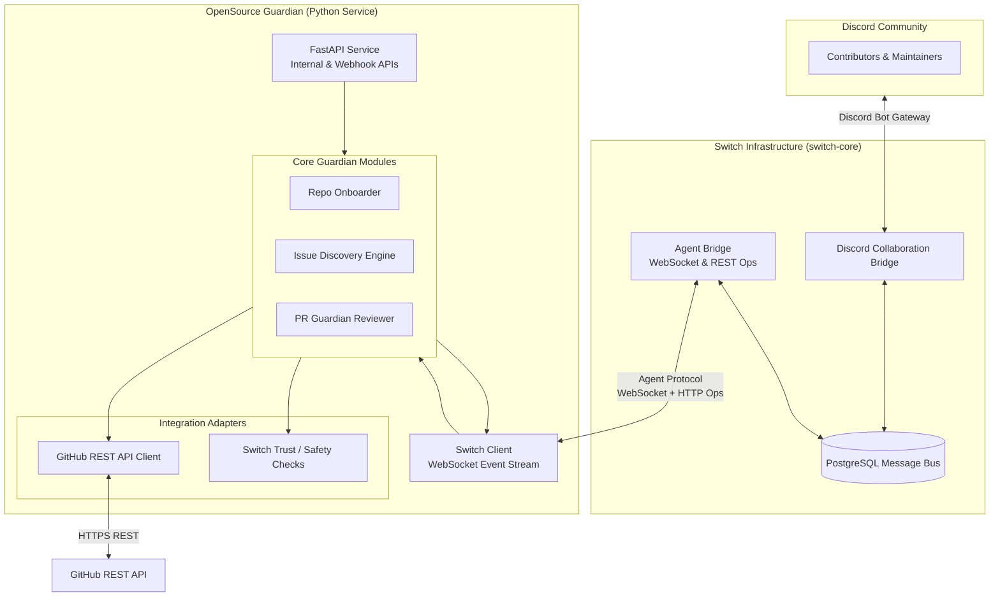
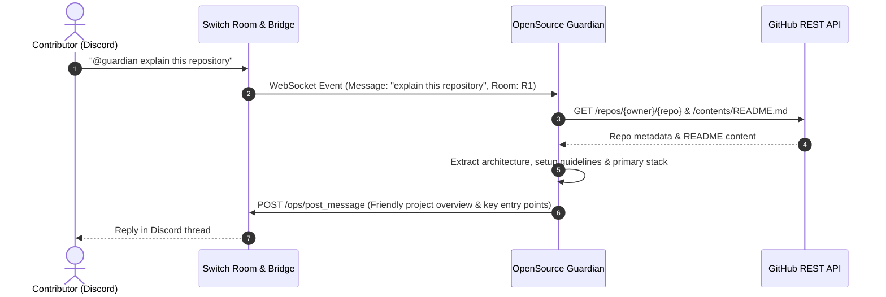
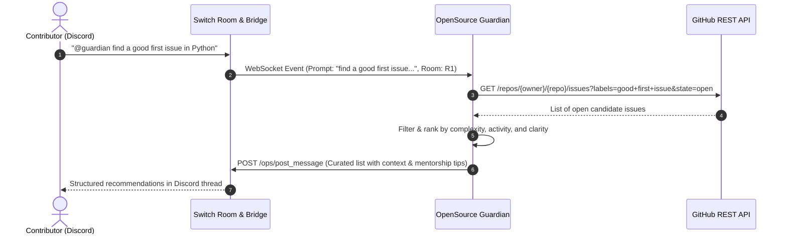
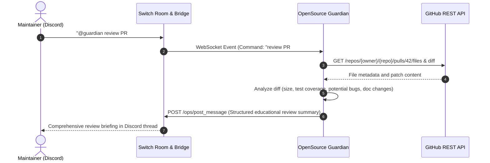

# OpenSource Guardian — System Architecture Specification

## 1. Product Overview

**OpenSource Guardian** is an AI-powered teammate designed for open-source communities, maintainers, and new contributors. It provides automated triage, educational code reviews, beginner-friendly issue discovery, and real-time collaboration inside developer chat channels (specifically Discord) through **Switch AI** (`switch-core`).

### Core Value Propositions
- **Repository Onboarding & Codebase Understanding**: Analyzes repository structure, documentation (`README`, `CONTRIBUTING`, architecture docs), and tech stacks to answer new contributor questions.
- **Beginner-Friendly Issue Discovery**: Curates and contextualizes "good first issue" candidates by evaluating complexity, file impact, and setup requirements.
- **Pull Request Analysis & Educational Review**: Provides constructive, pedagogical feedback on PR diffs, flagging potential bugs, missing tests, and style inconsistencies without arbitrary code execution.
- **Human-in-the-Loop Collaboration**: Maintains conversations inside Switch Rooms (bridged to Discord), allowing human maintainers and contributors to review suggestions, guide triage, and collaborate naturally.

---

## 2. High-Level Architecture & Major Components



### Component Responsibilities

1. **Switch Client (`switch_client.py`)**:
   - Manages connection lifecycle with Switch Agent Bridge.
   - Listens to incoming room events via WebSocket (`/agents/{agent_id}/connection/ws`).
   - Answers WebSocket pings every 2 seconds.
   - Dispatches incoming messages addressed to Guardian (`@opensource-guardian` or role-based triggers).
   - Sends outbound messages and replies using Switch REST operations (`POST /agents/{agent_id}/ops/post_message`).

2. **FastAPI Service (`api/`)**:
   - Serves internal health checks (`/health`) and diagnostic endpoints.
   - Provides optional webhook ingestion endpoints for GitHub webhook events (e.g. `pull_request.opened`, `issues.opened`) when live polling is not used.

3. **Repository Onboarder (`modules/onboarding.py`)**:
   - Fetches repository tree, markdown documentation, and config files from GitHub.
   - Builds in-memory summaries of contribution guidelines, coding conventions, and setup instructions.

4. **Issue Discovery Engine (`modules/issues.py`)**:
   - Fetches open issues via GitHub REST API filtered by labels (`good first issue`, `help wanted`, `documentation`).
   - Assesses issue scope, required skillset, and provides actionable starting points for newcomers.

5. **PR Guardian Reviewer (`modules/pr_guardian.py`)**:
   - Fetches pull request metadata, changed files, and git unified diffs via GitHub REST API.
   - Performs static heuristic checks (e.g. documentation updates, test additions, diff size).
   - Generates educational, constructive review summaries explaining *why* changes are recommended rather than just criticizing code.

6. **GitHub REST API Client (`adapters/github.py`)**:
   - Lightweight wrapper around `httpx` for GitHub API v3.
   - Handles rate limiting, authentication headers (`Bearer <token>`), and error responses.

7. **Safety & Policy Guardrails (`adapters/safety.py`)**:
   - Enforces strict execution safety: **no arbitrary code execution**, **no repository file modifications**, and **no automated PR merging**.

---

## 3. Integration Boundaries

### 3.1 Switch Integration Boundary

#### Verified Switch Capabilities (from `docs.switchagents.ai`):
- **Agent Protocol**: Agents communicate with `switch-core` Agent Bridge over standard HTTP and WebSocket.
- **Authentication**:
  - `AGENT_REGISTRATION_TOKEN` is used for one-time agent registration via `POST /agents`.
  - Registration returns an `{id, api_key}`.
  - All subsequent WebSocket connections and REST operations require `Authorization: Bearer <agent_api_key>`.
- **WebSocket Event Stream**:
  - Path: `GET /agents/{agent_id}/connection/ws?connection_id=<uuid>&rooms=<room_id>`.
  - Requires regular pong responses to server pings (every 2 seconds) to keep the connection alive.
  - Delivers room events containing sequential message IDs and message payloads.
- **REST Operations Registry**:
  - Discovered via `GET /agents/{agent_id}/ops`.
  - Invoked via `POST /agents/{agent_id}/ops/{operation_name}` with `X-Switch-Connection-Id: <connection_id>`.
  - Standard operations include `post_message`, `send_targeted_message`, `read_context`, `list_rooms`, and `connect_to_room`.
- **Discord Collaboration Bridge**:
  - `switch-core` contains a built-in Discord adapter that dials out to the Discord Gateway.
  - Maps Discord text channels to Switch Rooms and Discord users to Switch puppet identities.
  - Automatically manages message threads and correlation between Switch events and Discord messages.

#### Integration Details Requiring Implementation-Time Verification:
- Exact JSON payload structure received inside the WebSocket frame during Discord thread mentions.
- Behavior of `read_context` operation when retrieving past thread history.
- Local fallback runner option: running Guardian via Switch Console MCP loopback server vs. running standalone direct WebSocket daemon.

---

### 3.2 GitHub Integration Boundary

- **Protocol**: Standard HTTPS REST (`api.github.com`).
- **Authentication**: Personal Access Token (PAT) or GitHub App Installation Token via `Authorization: Bearer <GITHUB_TOKEN>`.
- **Endpoints Utilized**:
  - `GET /repos/{owner}/{repo}`: General repo metadata, default branch, language stats.
  - `GET /repos/{owner}/{repo}/contents/{path}`: Fetching `README.md`, `CONTRIBUTING.md`, etc.
  - `GET /repos/{owner}/{repo}/issues`: Querying issues by labels (`good first issue`).
  - `GET /repos/{owner}/{repo}/pulls/{pull_number}`: Fetching PR overview.
  - `GET /repos/{owner}/{repo}/pulls/{pull_number}/files`: Inspecting modified files.
  - `GET /repos/{owner}/{repo}/pulls/{pull_number}` with `Accept: application/vnd.github.v3.diff`: Retrieving raw diffs.
- **Strict Boundary**: All operations are **read-only** by default. Any automated PR comments must be explicitly requested and confirmed through a human maintainer in a Switch Room.

---

## 4. End-to-End Data Flows

### 4.1 Repository Onboarding Flow



### 4.2 Beginner-Friendly Issue Discovery Flow



### 4.3 Educational Pull Request Review Flow



---

## 5. Security & Safety Boundaries

1. **Zero Arbitrary Execution**:
   - The application does not clone untrusted code or run shell scripts/tests from target repositories. All static diff analysis is performed as parsed text.
2. **Read-Only GitHub Default**:
   - The default GitHub token scope requires only read access to public repositories (`public_repo`).
   - No automatic branch merging or direct write pushes will be permitted.
3. **Secret Isolation**:
   - API tokens (`SWITCH_AGENT_API_KEY`, `GITHUB_TOKEN`, `SECRET_KEYS`) are loaded exclusively from local `.env` files or environment variables and are strictly excluded from git tracking.
4. **Addressing Policies**:
   - Guardian responds only when explicitly addressed by name (`@guardian` or `@opensource-guardian`) or when triggered by authorized maintainers in designated triage channels to prevent noise and message loops.

---

## 6. Error Handling & Resilience Strategy

- **GitHub API Rate Limiting**:
  - Inspect `X-RateLimit-Remaining` and `X-RateLimit-Reset` headers.
  - Gracefully notify the room if GitHub rate limits are exhausted, indicating when the window resets.
- **WebSocket Disconnection / Reconnection**:
  - The Switch WebSocket client implements an exponential backoff reconnection loop.
  - Maintains `connection_id` and resumes from the last seen cursor (`start_from`) when reconnecting.
- **Ill-Formatted Requests & Missing Entities**:
  - When an issue or PR number cannot be found (404), return clear, empathetic feedback to the user rather than crashing or throwing unhandled stack traces.
- **Malformed Input & Timeouts**:
  - All external network calls (GitHub API and Switch REST API) enforce a 10-second timeout.

---

## 7. Proposed Directory Structure

```text
OpenSource-Guardian/
├── .gitignore
├── README.md
├── docs/
│   ├── ARCHITECTURE.md          # This system architecture specification
│   └── ROADMAP.md               # Milestone tracking and acceptance criteria
├── pyproject.toml               # Project metadata and dependencies (FastAPI, httpx, websockets)
├── config/
│   └── settings.py              # Pydantic BaseSettings for environment variables
├── src/
│   └── guardian/
│       ├── __init__.py
│       ├── main.py              # Service entry point
│       ├── adapters/
│       │   ├── __init__.py
│       │   ├── github_client.py # GitHub REST API integration
│       │   └── switch_client.py # Switch WebSocket & REST ops client
│       ├── modules/
│       │   ├── __init__.py
│       │   ├── onboarding.py    # Repository onboarding & documentation extraction
│       │   ├── issue_finder.py  # Issue discovery & filtering
│       │   └── pr_reviewer.py   # PR diff analysis & educational feedback generator
│       └── utils/
│           ├── __init__.py
│           └── formatting.py    # Discord/Markdown response formatters
└── tests/                       # Unit and integration tests
    ├── __init__.py
    ├── test_github_client.py
    └── test_modules.py
```

---

## 8. Key Architectural Decisions & Tradeoffs

| Decision | Rationale | Tradeoff / Constraint |
| :--- | :--- | :--- |
| **Python Runtimes & asyncio** | Rich ecosystem for AI and prompt engineering; native async support for WebSockets and HTTP via `websockets` and `httpx`. | Slightly higher memory baseline than Go/Rust, but ideal for a 4-day hackathon. |
| **Direct WebSocket Client** | Connects directly to `switch-core` Agent Bridge as a native Switch Agent, allowing standalone deployment in Docker or locally without requiring desktop GUI dependencies. | Requires implementing WebSocket heartbeat (ping/pong) and reconnect logic. |
| **No Database for Initial MVP** | Ephemeral, stateless architecture. GitHub holds repository state; Switch (PostgreSQL) holds chat and room state. | State is not persisted between service restarts, but avoids complex migration overhead. |
| **FastAPI for Tooling & Hooks** | Lightweight, async-first web framework with automatic OpenAPI docs. | Adds minimal server boilerplate, but simplifies potential GitHub webhook integrations. |
| **Static Text Analysis for PRs** | Parsing unified diffs and file trees via regex/heuristics rather than compiling/running untrusted PR code. | Cannot execute dynamic runtime testing, but guarantees 100% security against malicious PR execution. |
